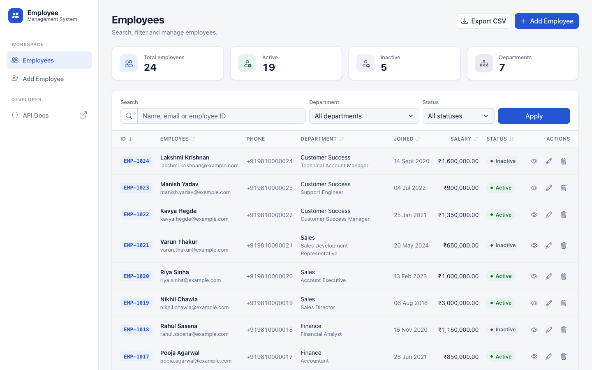
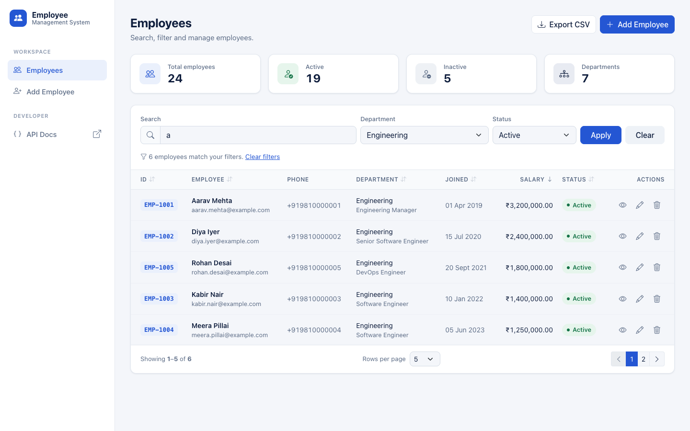
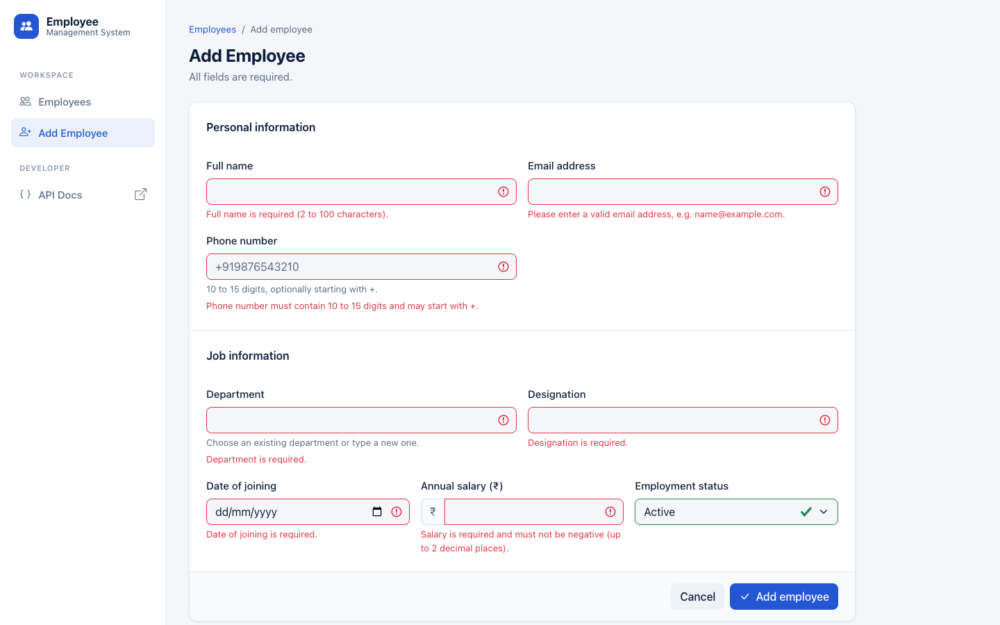
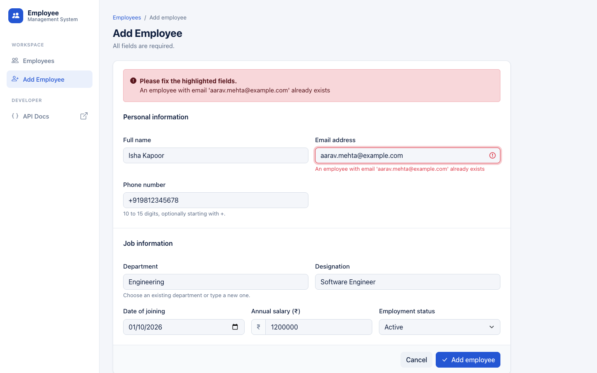
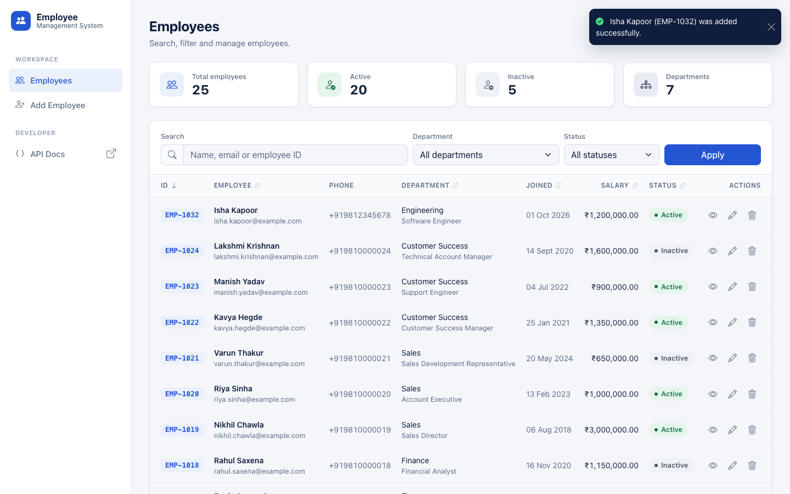
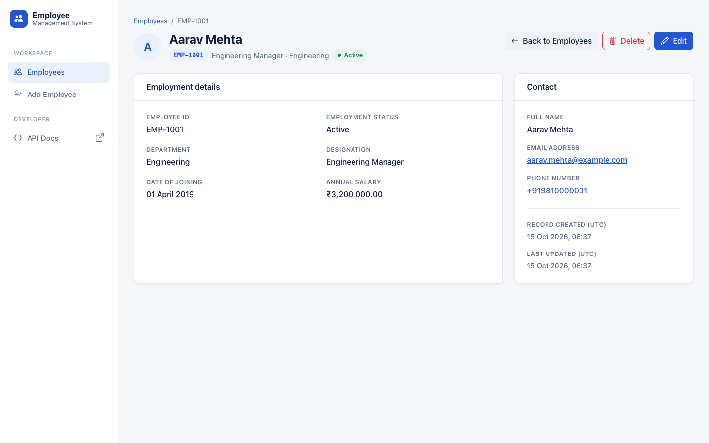
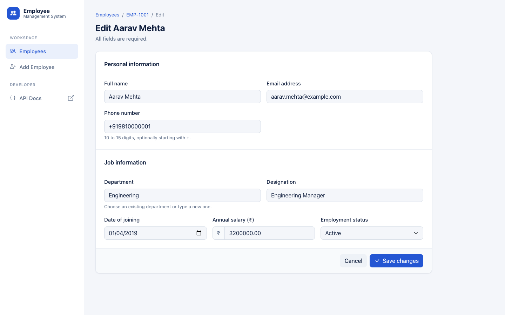
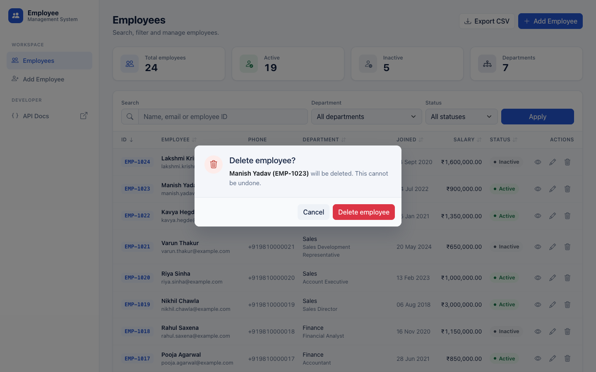
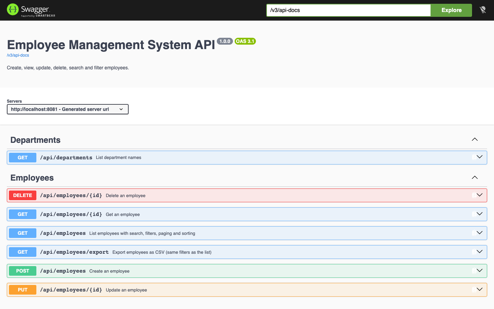
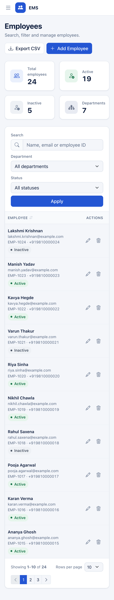

# Employee Management System

A web app to manage employees. Built with Java 17, Spring Boot, MySQL and Thymeleaf.

**Author:** Riya Mittal ([@Riyami28](https://github.com/Riyami28)). Built for the Kloudspot Software Engineer (Backend) assessment.



## Features

- Add, view, edit and delete employees.
- Delete asks for confirmation first.
- Each employee gets a unique ID, like `EMP-1001`.
- Search by name, email or employee ID.
- Filter by department and status.
- Page through results and choose the page size.
- Sort by clicking a column header.
- Forms are checked in the browser and on the server.
- A duplicate email shows a clear error message.
- Export the current list to CSV.
- REST API with Swagger docs and a Postman collection.
- Works on desktop, tablet and phone.

## Tech stack

- Java 17, Spring Boot 3.5
- Spring Web, Spring Data JPA, Bean Validation
- MySQL 8
- Thymeleaf and Bootstrap 5
- JUnit 5 and Mockito
- Swagger (springdoc-openapi)
- Maven (wrapper included)

## Run the project

You need **Java 17 or newer** and **Docker**.

**1. Create your settings file.** Then open `.env` and set your own passwords.

```bash
cp .env.example .env
```

**2. Start MySQL.**

```bash
docker compose up -d
```

**3. Start the app.** Run this from the project folder.

```bash
./mvnw spring-boot:run
```

**4. Open** http://localhost:8080

On Windows, use `copy` instead of `cp`, and `mvnw.cmd` instead of `./mvnw`.

### Using your own MySQL (without Docker)

Create the database and user:

```sql
CREATE DATABASE employee_db;
CREATE USER 'ems_user'@'localhost' IDENTIFIED BY 'your_password';
GRANT ALL PRIVILEGES ON employee_db.* TO 'ems_user'@'localhost';
```

Put the same values in `.env`, then start the app. The app creates the table itself.

## Settings

Settings are read from `.env`. This file is not committed to Git.

| Name | Default | Meaning |
|---|---|---|
| `DB_HOST` | `localhost` | MySQL host |
| `DB_PORT` | `3306` | MySQL port |
| `DB_NAME` | `employee_db` | Database name |
| `DB_USERNAME` | `ems_user` | Database user |
| `DB_PASSWORD` | – | Database password (required) |
| `MYSQL_ROOT_PASSWORD` | – | MySQL root password (Docker only) |
| `SERVER_PORT` | `8080` | App port |

## Database

- The table is defined in [schema.sql](src/main/resources/schema.sql).
- The app creates it on startup if it does not exist. Existing data is kept.
- Docker also loads 24 sample employees on the first start, from [seed-data.sql](database/seed-data.sql).
- To skip the sample data, delete the `02-seed-data.sql` line in `docker-compose.yml` before the first start.
- To reset everything, run `docker compose down -v`.

## Links

| Page | URL |
|---|---|
| App | http://localhost:8080 |
| Swagger UI | http://localhost:8080/swagger-ui.html |
| API docs (JSON) | http://localhost:8080/v3/api-docs |

## API

| Method | URL | What it does | Success |
|---|---|---|---|
| POST | `/api/employees` | Create an employee | 201 |
| GET | `/api/employees` | List employees | 200 |
| GET | `/api/employees/{id}` | Get one employee | 200 |
| PUT | `/api/employees/{id}` | Update an employee | 200 |
| DELETE | `/api/employees/{id}` | Delete an employee | 204 |
| GET | `/api/employees/export` | Download as CSV | 200 |
| GET | `/api/departments` | List department names | 200 |

**List options** for `GET /api/employees`:

- `page`: page number, starts at 0
- `size`: items per page, 1 to 100 (default 10)
- `search`: name, email or employee ID
- `department`: department name
- `status`: `ACTIVE` or `INACTIVE`
- `sortBy`: for example `fullName`, `salary`, `dateOfJoining`
- `sortDirection`: `asc` or `desc`

Example: `/api/employees?search=an&department=Engineering&status=ACTIVE&page=0&size=5`

**Request body** for create and update:

```json
{
  "fullName": "Ananya Sharma",
  "email": "ananya.sharma@example.com",
  "phoneNumber": "+919876543210",
  "department": "Engineering",
  "designation": "Software Engineer",
  "dateOfJoining": "2024-07-15",
  "salary": 850000.00,
  "status": "ACTIVE"
}
```

**Rules:**

- All fields are required.
- Email must be valid and unique.
- Phone must have 10 to 15 digits. It may start with `+`.
- Salary cannot be negative.
- Dates use the format `yyyy-MM-dd`.

**Errors:**

| Code | When |
|---|---|
| 400 | Invalid input |
| 404 | Employee not found |
| 409 | Email already exists |

Every error has the same JSON format:

```json
{
  "status": 400,
  "error": "Bad Request",
  "message": "Validation failed",
  "path": "/api/employees",
  "fieldErrors": { "email": "Please enter a valid email address" }
}
```

## Tests

```bash
./mvnw test
```

- 91 tests. All pass on Java 17 and Java 21.
- MySQL does not need to be running. The tests use an in-memory database.
- They cover the service, validation, controllers, database queries and a full end-to-end flow.
- One `ERROR` line about a duplicate key is expected. It comes from the test that checks duplicate emails are blocked.

## Postman

1. Import [the collection](postman/Employee-Management-System.postman_collection.json) into Postman.
2. Set the `baseUrl` variable if your app is not on port 8080.
3. Run the requests in order. The first request saves the new employee's ID for the others.

It has 17 requests with checks for success and error cases.

## Project structure

```
src/main/java/com/kloudspot/ems/
  controller/   Web pages and REST API
  service/      Business logic
  repository/   Database access
  entity/       Database table mapping
  dto/          Request and response objects
  exception/    Error handling
  mapper/       Converts between entity and DTO
  config/       Swagger setup
src/main/resources/
  templates/    HTML pages (Thymeleaf)
  static/       CSS and JavaScript
  schema.sql    Database table
src/test/       Tests
database/       Sample data
postman/        Postman collection
screenshots/    Screenshots of the app
```

**How a request flows:** Controller → Service → Repository → MySQL.

## Key design choices

- **Employee ID:** built from the database's auto-increment ID. This keeps it unique, even with many users at once. Deleted IDs are never reused.
- **Unique email:** checked in the code and enforced by the database.
- **Filters:** built with JPA Specifications. Only the filters you use are added to the query.
- **DTOs:** the API never returns the database entity directly.
- **Errors:** handled in one place. The API returns JSON, and the web pages show a friendly error page.
- **No secrets in code:** passwords come from `.env`.

## Screenshots

| | |
|---|---|
|  |  |
|  |  |
|  |  |
|  |  |
|  |  |

## Common problems

| Problem | Fix |
|---|---|
| `Set DB_PASSWORD in .env` | Run `cp .env.example .env` and set the passwords. |
| `Access denied for user` | The password in `.env` is wrong. If you changed it after the first start, run `docker compose down -v` and start again. This deletes the data. |
| `Communications link failure` | MySQL is not ready. Wait and check `docker compose ps`. |
| Port 3306 in use | Set `DB_PORT=3307` in `.env`. |
| Port 8080 in use | Set `SERVER_PORT=8081` in `.env`. |
| `JAVA_HOME` error | Install Java 17 or newer. |
| Page has no styling | Bootstrap loads from the internet. Check your connection. |

## Not included

- **Login (basic auth):** this was optional. It was left out to keep the core app stable.
- **Department management:** departments are typed on each employee. Existing names are suggested.
